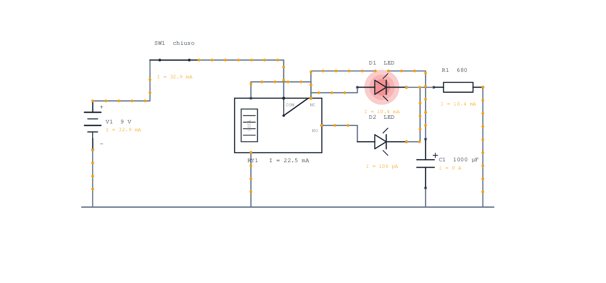
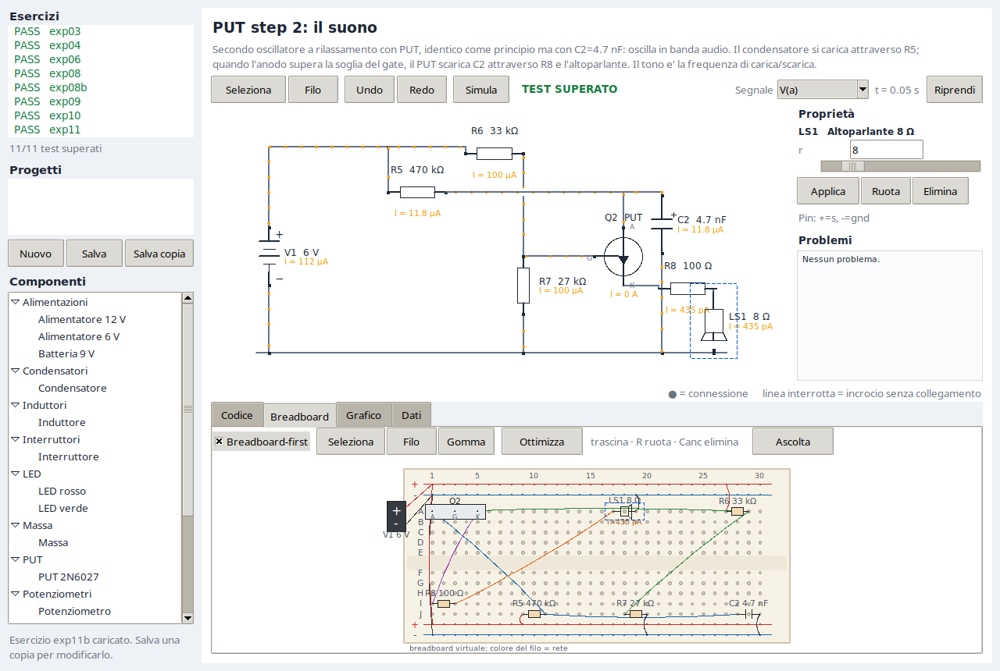

# Esercizi

Ogni esercizio e' un file `data/exercises/<id>.json` con circuito, note e
attese. `./lab run <id>` lo simula, `./lab check` li esegue tutti.

## Elenco

| id | Titolo | Analisi | Valori chiave | Cosa insegna |
|---|---|---|---|---|
| `exp03` | Il primo circuito | DC | `I(D1) = 15 mA`, `V(m) = 1.95 V` | la resistenza limita la corrente |
| `exp04` | Variare la tensione | DC | `I(D1) = 0.906 mA` a `pos = 0.5` | partitore resistivo, dimming |
| `exp06` | Accendere e spegnere | DC | `I(D1) = 15 mA` chiuso, `0` aperto | interruttore in serie |
| `exp08` | Oscillatore a rele' con due LED | Transitorio | 10.43 mA per LED, periodo ~0.46 s | contatti NC/NO, condensatore, isteresi |
| `exp08b` | Variante a due poli | Transitorio | 10.4/10.0 mA, periodo ~0.46 s | LED alternati su due contatti indipendenti |
| `exp09` | Tempo e condensatori | Transitorio | `V(m) = 5.68 V` a 10 s | costante di tempo `tau = R*C` |
| `exp10` | Il transistor come interruttore | DC | `Ic = 11.45 mA`, `Vce = 0.20 V` | NPN in cutoff, attivo e saturazione |
| `exp11` | Oscillatore a rilascio con PUT | Transitorio | picco 14.5 mA, periodo 1.04 s | PUT, carica RC, LED impulsivo |
| `exp11b` | PUT step 2: il suono | Transitorio | ~567 Hz, 5.7 mA di picco | secondo oscillatore in banda audio, altoparlante |
| `exp11c` | PUT step 3: amplificazione | Transitorio | ~627 Hz, 53.7 mA di picco | 2N2222 amplifica il PUT, altoparlante sul collettore |
| `exp11d` | PUT step 4: uscita pulsata | Transitorio | 420↔590 Hz, 53.7 mA di picco | due oscillatori, modulazione del gate, sirena |
| `exp13` | Friggere un LED | DC | `I(D1) = 720 mA` | senza resistenza il LED si brucia |
| `exp14` | Un bagliore pulsante | Transitorio | LED ~1 mA, impulsi morbidi ogni ~2 s | condensatori per accensione/spegnimento graduali |
| `lrc` | RLC serie | Transitorio | picco 9.14 V, `f0 = 15.9 Hz` | risonanza e smorzamento |
| `darlington` | Interruttore Darlington | DC | `Ic = 14.6 mA` da `Ib = 7.6 µA` | due NPN in cascata, guadagno ~1900 |

## Dettaglio

### exp03 - Il primo circuito

Batteria 9 V, resistenza 470 ohm, LED rosso. Il LED e' modellato con
`Vf = 1.8 V` e `Rd = 10 ohm`, quindi la corrente vale
`(9 - 1.8) / (470 + 10) = 15 mA`. La resistenza dissipa 106 mW, il LED 29 mW.

Esplorazioni:

```bash
./lab run exp03
./lab run exp03 --set R1.r=1k
./lab run exp03 --set R1.r=10
```

Con 10 ohm la corrente supera il massimo: il report mostra la violazione
`burned` e il controllo fallisce.

### exp04 - Variare la tensione

Potenziometro da 10 kohm come partitore, poi 470 ohm e LED. Con `pos = 0.5` il
cursore e' a 4.5 V e la corrente e' circa 0.906 mA. L'orientamento e':
`pos = 0` porta il cursore verso il pin 1 (9 V), `pos = 1` verso il pin 2 (0 V).

```bash
./lab sweep exp04 --sweep POT1.pos=0,0.25,0.5,0.75,1
```

La corrente scende da 15 mA a 0: e' il comportamento di un dimmer.

### exp06 - Accendere e spegnere

Interruttore in serie al gruppo resistenza-LED.

```bash
./lab run exp06
./lab run exp06 --set SW1.closed=false
```

Nel secondo caso la corrente e' nulla e l'attesa non e' soddisfatta: e' utile
per mostrare la differenza, non per validare l'esercizio.

### exp08 - Oscillatore a rele' con due LED



Il contatto NC alimenta la bobina (400 ohm), il condensatore da 1000 uF in
parallelo e il LED sinistro D1. Il contatto NO alimenta il LED destro D2. I due
catodi si uniscono e passano per la resistenza da 680 ohm verso massa.

- A riposo: NC chiuso, bobina e D1 alimentati, D2 spento.
- Eccitato: NC apre, NO chiude; D2 si accende, D1 resta acceso finche' il
  condensatore non scende sotto la tensione del nodo comune, poi si spegne.
- Il condensatore tiene eccitata la bobina per circa 0.44 s; sotto 3 V il rele'
  rilascia. Con `td = 0.02 s` la fase a riposo dura 20 ms.

Misure: `I(D1) = I(D2) = 10.43 mA` quando il rispettivo contatto e' chiuso;
periodo ~0.464 s. `V(nc)` scende da 9 V a 3 V durante la scarica. La sorgente
e' ideale, quindi la ricarica e' istantanea. Il lampo di D1 dura 20 ms: nella
GUI l'alone ha una persistenza di 250 ms per renderlo visibile.

```bash
./lab run exp08 --plot "I(D1)"
./lab run exp08 --plot "I(D2)"
./lab gui exp08
```

### exp08b - Rele' con due LED alternati

Variante a due poli: il polo 1 fa oscillare la bobina con il condensatore, il
polo 2 accende alternativamente i due LED. `NC2` alimenta il LED rosso tramite
680 ohm, `NO1` alimenta il verde tramite altri 680 ohm.

Con `td = 0.02 s` la fase a riposo dura 20 ms, quella eccitata circa 0.44 s
(periodo ~0.464 s):

- `I(D1)` (rosso) e' circa 10.43 mA quando `NC2` e' chiuso;
- `I(D2)` (verde) e' circa 10.0 mA quando `NO1` e' chiuso;
- i due LED non sono mai accesi insieme.

```bash
./lab run exp08b --plot "I(D1)"
./lab gui exp08b
```

Nell'editor si vedono i due bracci del rele' muoversi e i due LED scambiarsi.
Il contatto `NO2` resta scollegato ed e' marcato opzionale.

### exp09 - Tempo e condensatori

`R = 10 kohm`, `C = 1000 uF`, quindi `tau = 10 s`. Dopo una costante di tempo il
condensatore e' al 63% di 9 V, cioe' 5.69 V; dopo tre costanti e' al 95%.

```bash
./lab run exp09 --plot "V(m)"
./lab run exp09 --set R1.r=5k
```

Con 5 kohm la costante dimezza: il grafico si stringe.

### exp10 - Il transistor come interruttore

NPN con carico sul collettore (`R1 = 180 Ω`), LED e `R3 = 680 Ω` sull'emettitore,
base pilotata da `R2 = 10 kΩ` tramite il pulsante, `R4 = 100 kΩ` di pull-down.

- Pulsante chiuso: `Vbe ≈ 0.70 V`, `Vce ≈ 0.20 V`, `Ic ≈ 11.45 mA`; il
  transistor e' in saturazione e il LED e' acceso.
- Pulsante aperto: `R4` tiene la base a massa, `Vbe ≈ 0`, `Ic ≈ 0`; LED spento.

```bash
./lab run exp10
./lab run exp10 --set SW1.closed=false
```

Il modello e' un interruttore a tre stati, non Ebers-Moll; vedere
`docs/MODELS.md`.

### exp11 - Oscillatore a rilascio con PUT

`R1 = 470 kΩ` carica `C1 = 2.2 µF`; il partitore `R2/R3 = 15k/27k` fissa il gate
a `Vg = 3.857 V`; il PUT scatta a `Va = Vg + 0.6 = 4.457 V`, scarica il
condensatore attraverso `R4 = 100 Ω` e il LED, poi si spegne sotto `ihold`.

- `dt = 50 µs`, `tstop = 4 s`: la scarica e' risolta.
- Periodo ~1.036 s; picco LED ~14.5 mA (15.5 mA a 25 µs, entro il 10%).
- Senza `R4` il picco supera 30 mA e il LED si brucia: il test in
  `tests/test_physics.py` lo verifica.

```bash
./lab run exp11 --plot "I(D1)"
./lab gui exp11
```

### exp11b - PUT step 2: il suono



Versione isolata dello step 2: lo stesso oscillatore PUT di `exp11`, ma con
`C2 = 4.7 nF` al posto di 2.2 µF, così la frequenza sale in banda audio.

- `R5 = 470 kΩ`, `R6 = 33 kΩ`, `R7 = 27 kΩ`: gate a 2.7 V, soglia 3.3 V
- `C2 = 4.7 nF` carica attraverso R5
- il PUT scarica C2 attraverso `R8 = 100 Ω` e l'altoparlante da 8 Ω
- frequenza simulata: circa **567 Hz**, corrente di picco sull'altoparlante 5.7 mA

```bash
./lab run exp11b --play          # genera e riproduce il tono
./lab run exp11b --wav tone.wav  # salva il WAV
./lab gui exp11b                 # Ascolta in loop, poi Ferma
```

Il suono è il segnale reale dell'altoparlante (corrente impulsiva) risamplato e
compresso: contiene la fondamentale (~567 Hz) e le armoniche. Non è un modello
acustico. I player usati sono `paplay`, `pw-play`,
`aplay` o `ffplay`.

### exp11c - PUT step 3: amplificazione

Lo stesso oscillatore di `exp11b`, ma il segnale del PUT pilota la base di un
2N2222 attraverso `R9 = 1 kΩ`. Il collettore alimenta l'altoparlante da 8 Ω in
serie a `R8 = 100 Ω`; l'emettitore va a massa.

- `R10 = 10 kΩ` dalla base a massa tiene spento il 2N2222 tra un impulso e l'altro
- corrente di picco sull'altoparlante: **53.7 mA** (circa 10 volte lo step 2)
- frequenza simulata: circa **627 Hz**
- il suono è molto più forte; usa `./lab run exp11c --play` o il pulsante
  **Ascolta** in GUI (loop, poi **Ferma**)

La resistenza di pull-down R10 non è nella figura originale: serve a far
funzionare l'amplificatore anche nel modello semplificato del PUT.

### exp11d - PUT step 4: uscita pulsata (sirena)

Due oscillatori PUT: il lento `Q1` (a sinistra) e l'audio `Q2` (al centro), più
l'amplificatore a 2N2222. Il catodo di `Q1` pilota il gate di `Q2` tramite
`R11 = 10 kΩ`, con `C3 = 0,1 µF` che leviga i salti. A ogni impulso lento la
soglia di `Q2` cambia, quindi il tono acuto viene modulato (effetto "whoop").

- l'oscillatore lento fa oscillare il gate di `Q2` tra ~0 e ~3,7 V
- la frequenza alterna tra circa **420 e 590 Hz** (two-tone), con l'ampiezza che pulsa
- corrente di picco sull'altoparlante: **53.7 mA**

R1/C1 sono accordati (`47 kΩ` / `4,7 µF`) per un duty cycle ampio, così il whoop
è chiaro in una simulazione breve; nel circuito del libro sono `470 kΩ` / `2,2 µF`
e il whoop è più lento. Ascolta con `./lab run exp11d --play` o il pulsante
**Ascolta** in GUI (loop, poi **Ferma**).

### exp13 - Friggere un LED

LED collegato direttamente ai 9 V. Il modello a tratti da' 720 mA contro un
massimo di 30 mA: scatta `burned`. E' il contraltare di `exp03` e spiega a cosa
serve la resistenza.

```bash
./lab run exp13
./lab run exp03
```

### exp14 - Un bagliore pulsante

Esperimento 14 del libro. E' l'oscillatore a rilassamento con PUT di `exp11`,
modificato per far "respirare" il LED: C1 e' grande (100 µF) e si scarica
attraverso R4 (1 kΩ), quindi la salita e' graduale; C2 (220 µF nel libro)
immagazzina l'impulso e lo restituisce lentamente attraverso R5 (330 Ω) e il LED,
cosi' la luce sfuma invece di spegnersi di colpo. Alimentazione a 9 V.

- R1 = 33 kΩ, R2 = R3 = R4 = 1 kΩ, R5 = 330 Ω
- il LED si accende con impulsi morbidi (~1 mA di picco) e si spegne sfumando
- nel modello C2 e' **120 µF** invece di 220 µF: il LED a tratti conduce solo
  sopra 1,8 V, mentre quello reale a 9 V/220 µF si accende debolmente grazie
  alla curva esponenziale

```bash
./lab run exp14 --plot "I(D1)"
./lab gui exp14
```

### lrc - RLC serie

Gradino di 5 V su `R = 10 ohm`, `L = 1 H`, `C = 100 uF`. Frequenza naturale
`f0 = 1/(2*pi*sqrt(LC)) = 15.9 Hz`, smorzamento
`zeta = (R/2)*sqrt(C/L) = 0.05`. Il condensatore supera i 9 V prima di
assestarsi a 5 V: e' il ringing.

```bash
./lab run lrc --plot "V(m)"
./lab run lrc --set R1.r=200
```

Con 200 ohm lo smorzamento critico elimina l'oscillazione.

### darlington - Interruttore Darlington

Circuito originale (non dagli esercizi del libro) per mostrare il guadagno
composto. Due NPN in cascata: l'emettitore di `Q1` pilota la base di `Q2`, i
collettori sono entrambi al positivo. La base di `Q1` prende corrente attraverso
`R1 = 1 MΩ`, cioe' solo **7,6 µA**. `Q1` la amplifica (~1,8 mA), che diventa la
corrente di base di `Q2`, che satura e accende il LED con **14,6 mA**
(`R2 = 470 Ω` + LED).

- guadagno complessivo `Ic(Q2) / Ib(Q1)` ≈ **1900** (circa beta al quadrato)
- `Q2` e' in saturazione (`Vce ≈ 0,2 V`), quindi il LED e' acceso pieno
- serve una resistenza sul collettore (`R2`) per limitare la corrente del LED

```bash
./lab run darlington
./lab run darlington --set R1.r=100k   # piu' corrente di base, LED piu' luminoso
./lab gui darlington
```

## Come funziona la verifica

Il blocco `expect` confronta i risultati con i valori attesi. Per esempio:

```json
"expect": {
  "I(D1)": {"approx": 0.015, "tol": 0.05},
  "V(m)": {"at": 10, "approx": 5.69, "tol": 0.03, "min": 0, "max": 9.1},
  "violations": ["D1"]
}
```

`./lab check` esegue tutti gli esercizi e stampa `PASS` o `FAIL` con il
dettaglio. `./lab run <id> --strict` usa lo stesso criterio per un solo
esercizio.

## Aggiungere un esercizio

1. Copiare un file vicino e cambiare `id`, titolo, parti e reti.
2. Controllare la topologia con `./lab show <id>`.
3. Simulare con `./lab run <id>` e leggere nodi e correnti.
4. Scrivere `expect` con i valori ottenuti, con una tolleranza ragionevole.
5. Eseguire `./lab check`.

Un esercizio senza `expect` e' valido ma non verificabile: usare almeno un
controllo su corrente o tensione.

## Copertura e limiti

Coperti dal motore attuale: partitori, LED, interruttori, carica e scarica RC,
risonanza RLC, rele' con isteresi, potenziometri.

Non ancora coperti: transistori bipolari e MOSFET, timer 555, logica 74xx,
amplificatori operazionali, analisi in frequenza, trasformatori, altoparlanti,
motori e tutto cio' che richiede modelli non lineari o subcircuiti. Questi
richiedono nuovi `kind` o il fallback a ngspice descritto nella roadmap.
