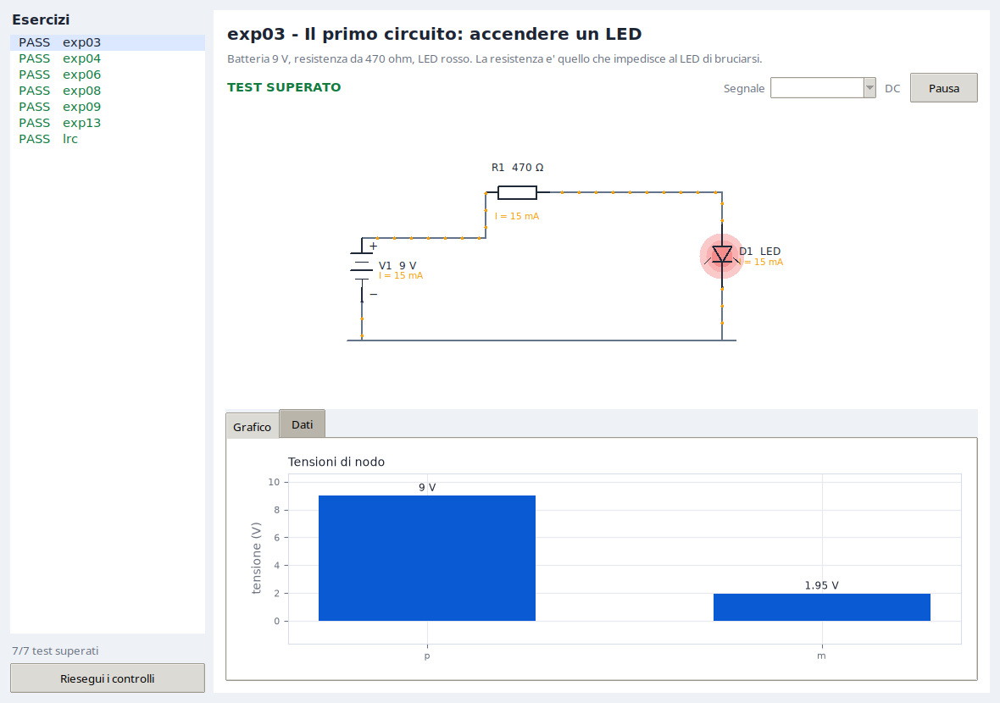
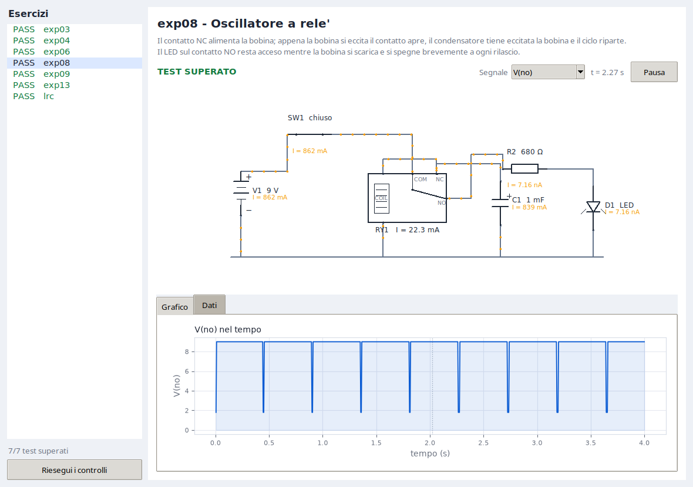
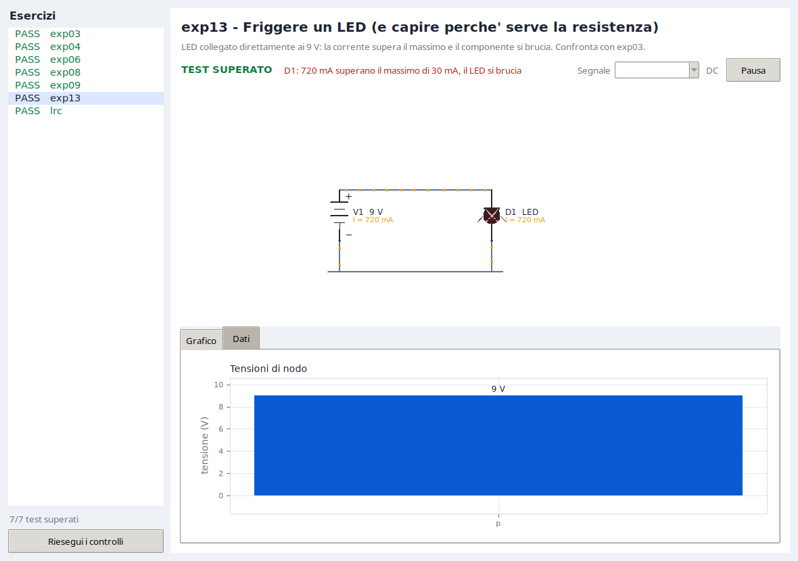

# Interfaccia grafica



## Avvio

```bash
./lab gui              # apre il primo esercizio
./lab gui exp08        # apre un esercizio specifico
```

Richiede Tkinter (incluso in Python su Linux) e Matplotlib. Il motore e la CLI
non ne hanno bisogno.

## Cosa si vede

- **Sinistra**: elenco degli esercizi con `PASS`/`FAIL`; il pulsante "Riesegui
  i controlli" ricalcola tutti gli esiti.
- **Intestazione**: titolo, note, stato del test e violazioni in rosso.
- **Schema**: il circuito disegnato, con corrente animata e LED accesi.
- **Sotto**: scheda "Grafico" con la forma d'onda selezionata e cursore
  temporale; scheda "Dati" con minimo, massimo e valore finale di ogni segnale,
  oppure correnti, tensioni e potenze in DC.

Controlli:

| Controllo | Effetto |
|---|---|
| `Pausa` / `Riprendi` | ferma o riavvia l'animazione e il cursore |
| `Segnale` | sceglie la forma d'onda da graficare |
| `Grafico` / `Dati` | cambia la scheda inferiore |
| `Riesegui i controlli` | ripete la verifica di tutti gli esercizi |

## Animazione

Il tempo del transitorio scorre in loop: la durata reale e' compresa fra 3 e 8
secondi, indipendentemente dalla durata simulata. Per esempio `exp09` (30 s)
scorre in 8 s, `lrc` (1.2 s) in 3 s.

Ogni componente ha una corrente interpolata all'istante corrente. I puntini
arancioni lungo i fili:

- si muovono con velocita' proporzionale a `|I|`, con un minimo e un massimo;
- cambiano verso con il segno della corrente;
- per le sorgenti di tensione il verso e' invertito, perche' la corrente
  convenzionale esce dal terminale positivo e all'interno torna indietro.

I LED si accendono con una scala logaritmica fra 1 uA e `imax`: correnti molto
piccole restano visibili, correnti vicine al massimo saturano. Il guasto
`burned` sostituisce l'alone con una X scura.



## Simboli

| Tipo | Simbolo |
|---|---|
| R | rettangolo con terminali |
| C | due piastre, `+` sul primo pin |
| L | quattro semicerchi |
| V | pila a piastre alternate, `+` e `-` |
| LED | triangolo con barra e alone luminoso |
| SW | lama aperta o chiusa secondo lo stato e `t_close`/`t_open` |
| POT | rettangolo con freccia del cursore |
| RELAY | scatola con bobina, contatti COM/NC/NO e braccio mobile |

I valori accanto ai simboli mostrano nome, valore e corrente istantanea.

## Layout

La geometria non sta nel JSON del circuito. `clab/layouts.py` associa a ogni
esercizio le posizioni:

```python
"exp03": {
    "gnd_y": 330,
    "parts": {
        "V1": (110, 230, 90),
        "R1": (330, 120, 0),
        "D1": (620, 210, 90),
    },
},
```

- coordinate virtuali su una tela `900 x 420`, scalata alla finestra;
- `(x, y, rot)` con `rot` in `{0, 90, 180, 270}` per i componenti a due pin;
- `rot = 0`: pin 1 a sinistra, pin 2 a destra;
- `rot = 90`: pin 1 in alto, pin 2 in basso;
- `gnd_y`: quota della rotaia di massa.

Pin speciali:

- potenziometro: `1` a sinistra, `2` a destra, `W` in alto;
- rele': `COIL+` e `COIL-` a sinistra, `COM` e `NC` in alto, `NO` a destra,
  con offset fissi rispetto al centro.

### Instradamento

1. La massa diventa una rotaia orizzontale a `gnd_y`, con una discesa da ogni
   pin e un puntino di giunzione.
2. Una rete a due pin usa un percorso ortogonale a L.
3. Una rete a tre o piu' pin usa un bus orizzontale alla quota media.

Quando il routing automatico non basta, il layout puo' dichiarare percorsi
espliciti:

```python
"routes": {
    "nc": [
        [(490, 180), (490, 150), (380, 150), (380, 180)],
        [(490, 180), (490, 160), (620, 160), (620, 195)],
    ],
},
```

Ogni lista e' una polilinea in coordinate virtuali. Serve per i casi con
contatti, diodi o incroci, come l'oscillatore a rele'.

### Aggiungere un layout

1. Simulare il circuito e leggere le reti con `./lab show <id>`.
2. Scegliere le posizioni su una griglia mentale `900 x 420`, lasciando spazio
   per le etichette a destra dei componenti verticali.
3. Aggiungere la voce in `clab/layouts.py`.
4. Aprire `./lab gui <id>` e correggere i fili con `routes` se serve.

Senza layout la GUI mostra un avviso: il circuito resta valido e simulabile da
CLI.

## Limiti

- E' un visualizzatore, non un editor: non si trascinano componenti.
- Niente zoom ne' pan; il disegno si adatta alla finestra.
- Il disegno viene ricreato a ogni frame: adatto a circuiti didattici, non a
  netlist grandi.
- Le sorgenti sono ideali: nell'oscillatore a rele' la ricarica del
  condensatore produce picchi di corrente molto brevi, visibili come spike.
- Il braccio del rele' segue la tensione di bobina con la sola isteresi
  `vpull`/`vdrop`; non c'e' rimbalzo meccanico.
- I layout coprono gli esercizi inclusi; per gli altri serve aggiungerne uno.


