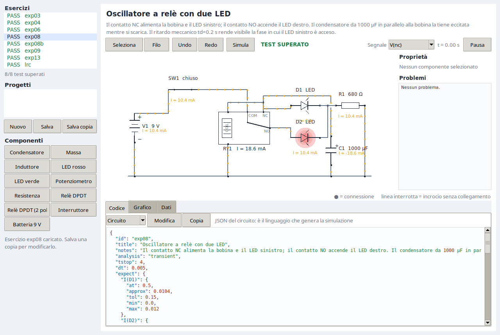
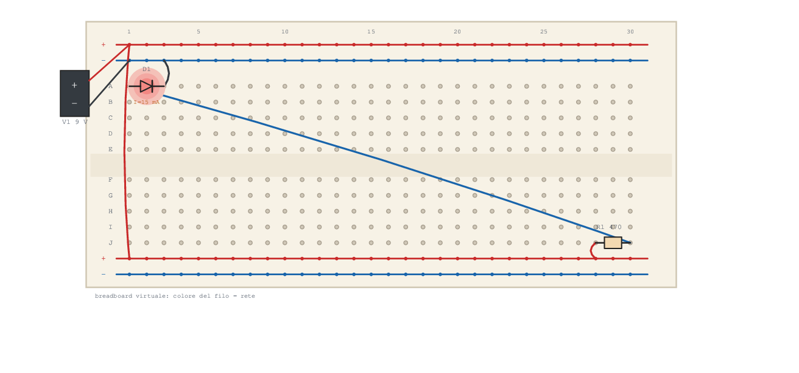
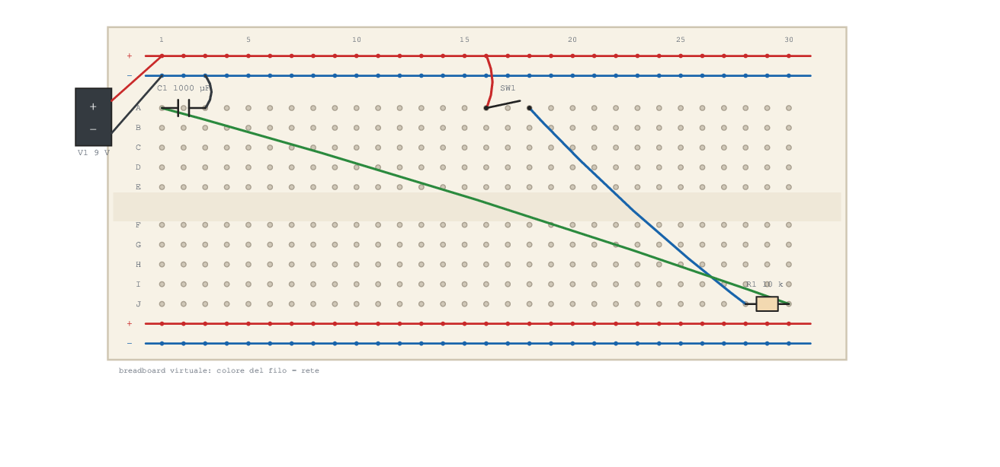

# Interfaccia grafica ed editor



## Avvio

```bash
./lab gui              # apre il primo esercizio
./lab gui exp08b       # apre un esercizio specifico
```

Richiede Tkinter (incluso in Python su Linux) e Matplotlib. Il motore e la CLI
non ne hanno bisogno.

## Struttura della finestra

- **Sinistra**: esercizi con `PASS`/`FAIL`, progetti utente, pulsanti
  `Nuovo`/`Salva`/`Salva copia`, palette dei componenti.
- **Centro**: schema del circuito. Sopra ci sono modalità, undo/redo, stato,
  segnale, orologio e pausa.
- **Destra**: proprietà del componente selezionato e problemi del circuito.
- **Sotto**: schede `Codice`, `Grafico`, `Dati`.

## Modalità

| Modalità | Come si usa |
|---|---|
| `Seleziona` | clicca un componente per selezionarlo, trascinalo per spostarlo |
| `Filo` | clicca il primo pin, poi il secondo; la rete viene creata o unita |
| palette | clicca un componente, poi clicca sulla tela per posizionarlo |

Tasti:

| Tasto | Azione |
|---|---|
| `R` | ruota il componente selezionato di 90 gradi |
| `Canc` | elimina il componente selezionato |
| `Esc` | annulla filo, posizionamento o selezione |
| `Ctrl+Z` / `Ctrl+Y` | undo / redo |
| `Ctrl+S` | salva |
| `Ctrl+N` | nuovo circuito |

La griglia di posizionamento e' da 10 px. I fili sono instradati
automaticamente: rotaia di massa in basso, percorsi a L per le reti a due pin,
bus per le reti con piu' pin. I layout possono dichiarare percorsi espliciti.

## Componenti

La palette e' generata dal catalogo `data/components/`: aggiungere un file JSON
aggiunge un pulsante. Sono disponibili resistenze, condensatori, induttori,
batterie, LED rossi e verdi, interruttori, potenziometri, rele' a un polo, rele'
a due poli e il simbolo di massa.

La **massa** e' un componente con un pin: quando lo posizioni, il pin entra
nella rete `gnd`. Collegando qualunque altro pin al simbolo di massa, l'intera
rete viene unita a `gnd`.

Il **rele' a due poli** (`relay_2p`) ha due deviatori indipendenti mossi dalla
stessa bobina. I contatti `NO1` e `NO2` sono opzionali: un polo puo' restare
inutilizzato senza generare errori.

## Proprietà

Selezionando un componente compaiono:

- identificatore e tipo;
- i parametri del catalogo, modificabili (valori con suffissi SI come `4.7k`);
- `Applica`, `Ruota`, `Elimina`;
- l'elenco dei pin con la rete a cui sono collegati;
- uno **slider live** per `v`, `pos`, `r`, `rtotal`, `c`, `l`: la simulazione
  si aggiorna con un debounce di 160 ms, senza ricostruire il pannello durante
  il trascinamento.

I valori numerici vengono validati prima dell'applicazione. Dopo ogni modifica
la simulazione viene ricalcolata e lo schema aggiornato.

## Pannello Codice

La scheda `Codice` mostra il linguaggio che genera il circuito.

- `Circuito`: il JSON semantico, lo stesso che userebbe un LLM.
- `Layout`: il JSON della disposizione (posizioni, rotazioni, percorsi).
- `Copia`: copia negli appunti.
- `Modifica` / `Applica`: abilita la modifica del testo, valida il JSON e
  ricostruisce il documento.

Quando si applica il circuito, i componenti già presenti mantengono la loro
posizione; quelli nuovi vengono posizionati automaticamente. I componenti
rimossi spariscono anche dal layout. Se il JSON non è valido, il testo resta
aperto e il motivo compare nel messaggio in basso a sinistra.

## Progetti

- `Nuovo`: documento vuoto.
- `Salva`: salva il progetto corrente.
- `Salva copia`: chiede un nome e scrive in `data/projects/`.
- Selezionare un progetto dalla lista lo apre.

Ogni progetto ha due file:

```
data/projects/mio_circuito.json
data/projects/mio_circuito.layout.json
```

Il primo è il circuito, il secondo è solo geometria. Gli esercizi integrati
sono protetti: per modificarli bisogna salvarne una copia. Se ci sono modifiche
non salvate, il passaggio a un altro esercizio o progetto chiede conferma.

## Animazione

Il tempo del transitorio scorre in loop: la durata reale è compresa fra 3 e 8
secondi. Ogni componente ha una corrente interpolata all'istante corrente:

- i puntini arancioni lungo i fili si muovono con velocità proporzionale a
  `|I|` e cambiano verso con il segno;
- per le sorgenti di tensione il verso è invertito, perché la corrente
  convenzionale esce dal positivo;
- i LED usano una scala logaritmica fra 1 uA e `imax`, così anche correnti
  piccole restano visibili; un LED bruciato mostra una X;
- l'alone dei LED ha una persistenza di circa 250 ms reali: un impulso da
  20 ms, come quello del relè in exp08, resta visibile per alcuni frame;
- il cursore sul grafico segue l'animazione; `Pausa` ferma tutto.

## Convenzioni di disegno

- un **pallino scuro** su un nodo indica una connessione;
- quando due fili di reti diverse si incrociano, il filo verticale viene
  **interrotto**: non c'e' collegamento;
- un incrocio tra fili della **stessa rete** ha il pallino, perche' e' una
  connessione.

La stessa legenda compare sotto lo schema.

## Breadboard 2D



La scheda **Breadboard** mostra il circuito su una breadboard virtuale:
fori, rail di alimentazione, componenti e jumper colorati per rete.

- il layout e' **generato automaticamente** dal circuito per ogni esercizio e
  progetto: niente layout scritti a mano
- il placer assegna righe e colonne, usa i rail per massa e alimentazione,
  gestisce moduli multi-pin (potenziometro, NPN, PUT, relè) e tiene le
  alimentazioni fuori board
- i jumper di segnale collegano i pin della stessa rete; `validate_layout()`
  ricostruisce la connettivita' (colonne A-E/F-J, rail, jumper) e verifica
  reti aperte e corti
- il test `tests/test_breadboard.py` genera e valida tutti gli esercizi, prova
  il determinismo, la rimozione di un pin e un corto artificiale
- **Ottimizza disposizione** rigenera il layout distribuendo i componenti alla
  massima distanza (greedy farthest-point su righe/colonne, usa anche i rail
  inferiori); riduce le sovrapposizioni di etichette e moduli
- **editing**: trascina un componente da un foro all'altro (snap al foro), `R`
  per ruotare, `Canc` per eliminare; i jumper vengono ri-rotati, il layout e'
  validato e salvato in `<progetto>.board.json`
- undo/redo includono il layout della breadboard; la scheda `Codice` ha la
  vista `Breadboard` per vedere/modificare il JSON fisico
- aggiungere un componente dallo schema rigenera la breadboard (le posizioni
  manuali vengono perse); i jumper manuali e la derivazione delle reti sono il
  passo successivo (breadboard-first)



## Simboli

| Tipo | Simbolo |
|---|---|
| R | rettangolo con terminali |
| C | due piastre, `+` sul primo pin |
| L | quattro semicerchi |
| V | pila a piastre alternate, `+` e `-` |
| LED | triangolo con barra e alone luminoso |
| SW | lama aperta o chiusa |
| POT | rettangolo con freccia del cursore |
| RELAY | scatola con bobina, COM/NC/NO e braccio mobile |
| RELAY2 | scatola con bobina e due bracci, COM/NC/NO per polo |
| GND | tre linee decrescenti |

## Layout

Per gli esercizi integrati i layout stanno in `clab/layouts.py`; per i progetti
nel file `.layout.json` affiancato. Formato:

```json
{
  "version": 1,
  "gnd_y": 330,
  "parts": {
    "V1": [110, 230, 90],
    "R1": [330, 120, 0],
    "D1": [620, 210, 90]
  },
  "routes": {
    "nc": [
      [[490, 180], [490, 150], [380, 150], [380, 180]]
    ]
  }
}
```

- coordinate virtuali su una tela `900 x 420`, scalata alla finestra;
- `(x, y, rot)`; `rot` in `{0, 90, 180, 270}` per i componenti a due pin;
- `rot = 0`: pin 1 a sinistra, pin 2 a destra;
- `rot = 90`: pin 1 in alto, pin 2 in basso;
- `gnd_y`: quota della rotaia di massa;
- `routes`: polilinee esplicite, usate quando l'instradamento automatico non
  basta.

Pin speciali: potenziometro `1` a sinistra, `2` a destra, `W` in alto; rele' a
due poli con bobina a sinistra, polo 1 in alto, polo 2 in basso e `NO` sul lato
destro.

## Limiti

- La tela non ha zoom né pan.
- Il disegno viene ricreato a ogni frame: adatto a circuiti didattici.
- I fili sono instradati automaticamente; non si trascinano i punti di piega.
- Il braccio del relè segue lo stato simulato; `td` è un ritardo meccanico
  lumped, non un modello dell'armatura.
- Le sorgenti sono ideali: nell'oscillatore la ricarica del condensatore produce
  picchi di corrente molto brevi.
- I modelli di NPN e PUT sono comportamentali, non SPICE completi: vedere
  `docs/MODELS.md`.
- Il pannello Codice applica il JSON in un colpo solo; non c'è merging con le
  modifiche fatte nel frattempo sulla tela.


