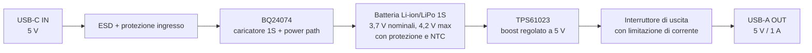

# Progetto: power bank 1S con USB 5 V

Prima proposta hardware: una cella Li-ion/LiPo, ingresso USB-C a 5 V per la
ricarica e uscita USB-A regolata a 5 V. L'uscita è dimensionata per 1 A. I due
connettori sono separati e la porta di uscita può restare attiva mentre la
batteria si carica.

## Schema a blocchi

Connessioni funzionali:

- `J1 USB-C IN`: VBUS a 5 V e GND al BQ24074. Per il ruolo sink USB-C, mettere
  un resistore `Rd = 5,1 kΩ` da ciascun pin CC1 e CC2 a GND. Non negoziare
  tensioni USB-PD superiori a 5 V in questa prima versione.
- `U1 BQ24074`: ingresso dal connettore; `BAT` alla cella; `OUT` è il rail di
  sistema. Per la versione base, selezionare USB500 (`EN1=1`, `EN2=0`) e
  impostare `ISET` a circa 500 mA. Collegare `TS` al termistore NTC previsto
  dal datasheet e fissato alla cella. Collegare il pad termico esposto al
  piano VSS/GND. `CHG` e `PGOOD` possono pilotare due LED con le resistenze
  prescritte dal datasheet.
- `BAT+` e `BAT−`: usare una cella singola con protezione contro
  sovraccarica, sovrascarica e sovracorrente, oppure un circuito di protezione
  dedicato dimensionato per la cella. Il boost parte dai terminali protetti
  della batteria.
- `U2 TPS61023`: collegare `VIN` alla batteria protetta, `GND` alla massa,
  mettere l'induttore tra `VIN` e `SW`, e collegare `VOUT` al condensatore
  d'uscita e alla porta USB-A. Configurare `FB` per 5,0 V secondo il partitore
  e i valori del datasheet; `EN` controlla l'accensione dell'uscita.
- `J2 USB-A OUT`: VBUS dal TPS2553, usato come interruttore elettronico con
  limite di corrente e protezione termica; GND comune. Per il limite minimo di
  1 A, `RILIM = 23,7 kΩ` produce un limite massimo tipico calcolato di circa
  1,17 A: il valore reale va verificato con tolleranze e datasheet. Un
  resistore da `100 Ω` tra D+ e D− presenta la segnalazione DCP legacy; verificare
  che corrisponda al profilo USB richiesto. Aggiungere array ESD sulle linee.

## Dimensionamento iniziale

| Blocco | Scelta iniziale | Nota |
|---|---|---|
| Cella | 1S Li-ion/LiPo protetta, 2.000–3.000 mAh | Corrente di scarica continua dichiarata di almeno 2 A; tensione finale di carica 4,2 V solo se prevista dal produttore della cella. |
| Caricatore | BQ24074 | Caricatore lineare autonomo per una cella, con power path, ingresso USB selezionabile 100/500 mA, NTC e protezioni. |
| Corrente di carica | 300–500 mA, da fissare con `ISET` | Non superare la corrente specificata per la cella. Il limite USB va rispettato anche se il caricatore può essere configurato per correnti maggiori. |
| Convertitore boost | TPS61023 | Uscita impostata a 5,0 V; limite interno di corrente di commutazione 3,7 A tipico, che **non** equivale a 3,7 A disponibili sul connettore. |
| BQ24074 | `CIN = 1 µF`, `CBAT = 4,7 µF`, `COUT = 4,7 µF`; `RISET ≈ 1,78 kΩ` | Valori di partenza dalle applicazioni TI; verificare variante/package e datasheet prima del PCB. La legge tipica è `ICHG ≈ 890 / RISET` con ohm e ampere. |
| TPS61023 | `L1 = 1 µH`, `CIN = 10 µF`, `COUT = 2 × 22 µF`; partitore FB `732 kΩ / 100 kΩ` | Esempio TI per 5 V da cella 1S. Condensatori ceramici X7R/X5R con capacità effettiva e tensione nominale adeguate. |
| Uscita USB | TPS2553, `RILIM = 23,7 kΩ`; `RDCP = 100 Ω` | La soglia calcolata varia con tolleranze: circa 1,0–1,17 A secondo le equazioni TI. |

### Correnti e autonomia

A 5 V e 1 A l'uscita eroga 5 W. Assumendo, per una stima, rendimento boost
del 90% e batteria a 3,3 V, la batteria fornisce circa
`5 W / (0,90 × 3,3 V) = 1,68 A`. La cella e il circuito di protezione devono
quindi sostenere almeno questa corrente, con margine per transitori e
tolleranze. Se la cella è a 3,0 V il valore sale a circa 1,85 A.

Con ingresso USB limitato a 500 mA, la potenza disponibile è circa 2,5 W prima
delle perdite: durante un'uscita da 5 W la batteria si scarica anche se il cavo
di ricarica è collegato. Il power path alimenta il sistema e gestisce la
ricarica; non crea potenza aggiuntiva. Per ricaricare e alimentare l'uscita
senza scaricare la cella serve un alimentatore adeguato e una corretta
negoziazione/limitazione della corrente in ingresso.

## Note per realizzare la scheda

1. Scegliere una cella specifica e leggere il suo datasheet prima di fissare
   `ISET`, soglia termica e corrente di scarica ammessa.
2. Usare la protezione della cella, un connettore polarizzato e un fusibile o
   una protezione equivalente vicino al terminale batteria.
3. Per USB-C, i resistori `Rd` dichiarano il dispositivo come sink; questa
   versione resta a 5 V e limita l'assorbimento a 500 mA. Correnti maggiori
   richiedono il rilevamento della corrente annunciata dalla sorgente Type-C e
   una configurazione coerente del caricatore.
4. Il caricatore lineare dissipa calore. A 5 V, 500 mA e batteria a 3,3 V la
   dissipazione teorica durante la carica è circa `(5 − 3,3) × 0,5 = 0,85 W`;
   verificare temperatura e rame di dissipazione sul PCB.
5. Il boost può raggiungere correnti elevate sul lato batteria. Tenere corti e
   larghi i percorsi cella–induttore–integrato–condensatori; seguire le regole
   di layout del datasheet TPS61023 e verificare termicamente il prototipo.
6. Il valore finale di `ISET`, il circuito TS, l'interruttore USB con limite di
   corrente e la segnalazione D+/D− vanno chiusi sullo schema elettrico
   definitivo usando i datasheet e la cella scelta. I valori TPS61023 riportati
   sono quelli dell'applicazione TI 5 V / 1,5 A; qui l'uscita è limitata a 1 A
   nominale.

Lo schema del progetto include i due resistori CC da 5,1 kΩ, il timer del
BQ24074, il TPS2553 con `RILIM = 23,7 kΩ`, la resistenza DCP da 100 Ω, TVS ed
array ESD.

## Modello di simulazione in Elettrolab

Il progetto usa sorgente esterna VUSB a 5 V, cella ideale a 3,7 V e carico di
prova RLOAD da 5 Ω. VUSB e RLOAD sono marcati `simulation_only`, quindi non
appaiono nella BOM o nella PCB. S1 è chiuso all'avvio per abilitare l'uscita.

Il solver usa equivalenti comportamentali: BQ24074 trasferisce VIN a OUT e
immette la corrente ricavata da RISET; TPS61023 regola il modello medio
dell'uscita dalla rete FB e assorbe dalla batteria la potenza calcolata con
rendimento fisso del 90%; TPS2553 applica l'interruttore EN e il limite nominale
calcolato da RILIM; il PCM conduce nell'intervallo 2,5–4,3 V. NTC è una
resistenza fissa; USB-C/A sono connettori passivi e i dispositivi ESD/TVS sono
aperti in DC.

Questa prova permette di verificare il punto operativo nominale e il limite
USB semplificato. Non riproduce la carica CC/CV completa, lo stato di carica o
la tensione variabile della cella, ripple PWM, soft-start, accuratezze,
limiti termici, tutte le protezioni o i transitori. I risultati non validano
hardware o sicurezza della batteria.

La GUI mostra anche l'anteprima PCB a un lato: il controllo attuale non rileva
violazioni DRC, ma il router lascia collegamenti non instradati. Non è una
scheda pronta. I footprint di connettori e moduli esterni sono segnaposto
generici da rimpiazzare dopo la scelta dei codici commerciali.

## Riferimenti tecnici

- [Datasheet TI BQ2407x](https://www.ti.com/lit/ds/symlink/bq24074.pdf): caricatore 1S autonomo, selezione limite USB, power path, ingresso NTC e protezioni.
- [Datasheet TI TPS61023](https://www.ti.com/lit/ds/symlink/tps61023.pdf): convertitore boost sincrono regolabile, protezione da corto e sovratemperatura, uscita fino a 5,5 V.
- [Datasheet TI TPS2553](https://www.ti.com/lit/ds/symlink/tps2553.pdf): interruttore USB con limite di corrente programmabile e protezioni.
- [BQ24074EVM](https://www.ti.com/tool/BQ24074EVM) e [TPS61023EVM-052](https://www.ti.com/product/TPS61023EVM-052): schede TI per verificare separatamente i due blocchi.
